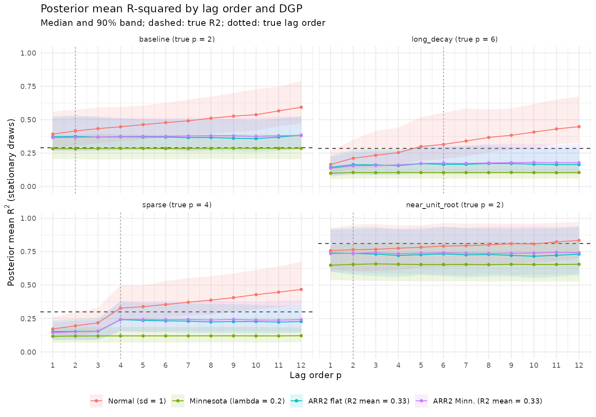

<!--
HOW TO USE THIS DRAFT
- Text in [brackets]{.todo} is a placeholder: replace or delete it.
- Bullets are example wording; keep, edit or cut.
- "::: notes" blocks are speaker notes (press S in the browser to see them).
- Figures point at the paths the notebooks save to. The VAR figures exist only after
  rendering the sweep results notebooks (they are not committed), so render those first
  or pull them from DEAC.
- Render with:  quarto render presentation/proposal-presentation.qmd
-->

## Roadmap

1. AR and VAR models
2. What is R² in a time series?
3. Bayesian VARs and the usual priors
4. R2D2 and the ARR2 prior
5. ARR2 in the AR case: what the R² prior actually controls
6. Extending ARR2 to VARs: simulation results
7. Future work

::: notes
[One sentence on the big picture]{.todo}, e.g.: "Priors in VARs are usually set coefficient by coefficient. I'm studying priors set on the fit of the whole model instead, and checking what they actually control."
:::

# AR and VAR models

## Autoregressions

An AR($p$) model for a single series:

$$
y_t = c + \sum_{i=1}^{p} \phi_i\, y_{t-i} + \varepsilon_t, \qquad \varepsilon_t \sim N(0, \sigma^2)
$$

- Today's value is a linear function of the last $p$ values plus a shock.
- Stationary when all roots of $1 - \phi_1 z - \dots - \phi_p z^p$ lie outside the unit circle.
- [Example application: consumer sentiment (UMich index)]{.todo}

::: notes
Keep this short; the audience knows regression. Emphasise that the regressors are the series' own past, which matters later.
:::

## Vector autoregressions

A VAR($p$) with $N$ series:

$$
y_t = c + \sum_{i=1}^{p} A_i\, y_{t-i} + u_t, \qquad u_t \sim N(0, \Sigma)
$$

- Each $A_i$ is $N \times N$: every series depends on the past of every series.
- $N^2 p$ coefficients: $N = 8$, $p = 4$ already gives 256.
- Used for forecasting, impulse responses and variance decompositions in macroeconomics.

::: notes
The coefficient count is the motivation for shrinkage. [Optional: mention an applied VAR with sentiment, unemployment, inflation.]{.todo}
:::

# What is R² in a time series?

## Two notions of R²

**Population R²** (a property of the parameters): for equation $k$,

$$
R^2_k = 1 - \frac{\Sigma_{kk}}{\Gamma_{0,kk}}, \qquad \Gamma = F\,\Gamma F' + Q \;\; \text{(Lyapunov / multivariate Yule--Walker)}
$$

- Requires a stationary model; $\Gamma_0$ is the model's own variance.

**Bayesian R²** [@gelman2019r2] (fit on the observed data, per posterior draw):

$$
R^2_{B,k} = \frac{\operatorname{Var}(\hat\mu_{k})}{\operatorname{Var}(\hat\mu_{k}) + \sigma_k^2}, \qquad \hat\mu_{k,t} = \textstyle\sum_i (A_i\, y_{t-i})_k
$$

- Uses the observed lags; defined for every draw, stationary or not.

::: notes
Example wording: "Population R² asks how much of the variance this process would explain. Bayesian R² asks how much of the variance of the observed series these parameters explain. They agree when the data pin down the parameters, and they can be very different in the prior."
:::

## System R²: the trace

$$
R^2_{\text{trace}} = 1 - \frac{\operatorname{tr}\Sigma}{\operatorname{tr}\Gamma_0} = \sum_k w_k R^2_k, \qquad w_k = \frac{\Gamma_{0,kk}}{\operatorname{tr}\Gamma_0}
$$

- A variance-weighted average of the per-equation R².
- On standardized data the weights are (nearly) equal: the plain mean.
- Same construction for Bayesian R²: $\sum_k v_k / \left(\sum_k v_k + \operatorname{tr}\Sigma\right)$.

![[TODO: save p_r2_sigma from var-2-prior.qmd with ggsave and point this at it]](../notebooks/var/figures/r2_variants_by_sigma.png){fig-align="center" width="80%"}

::: notes
Example: "The trace version is order-invariant and is what my VAR prior targets. The determinant version would also account for correlated shocks; that is future work."
:::

# Bayesian VARs

## The usual priors

**Independent normal:** $A_{i,nk} \sim N(0, s^2)$ for every coefficient.

**Minnesota** [@litterman1986], hierarchical as in @giannone2015prior and @chan2021minnesota:

$$
\operatorname{sd}(A_{i,nn}) = \frac{\lambda}{i^{d}}, \qquad
\operatorname{sd}(A_{i,ng}) = \frac{\lambda\,\theta}{i^{d}}\,\frac{s_n}{s_g} \quad (g \ne n)
$$

- $\lambda$: overall tightness, Gamma prior (mode 0.2, sd 0.4)
- $\theta$: cross-variable tightness, Beta(2, 2)
- $d$: lag decay, Gamma prior (mode 1, sd 0.5)

::: notes
All three Minnesota scales are learned from the data in my comparisons, so it is the strongest version of the standard prior, not a straw man.
:::

## Priors on coefficients imply priors on fit

- Each coefficient's prior adds signal variance, so the implied fit depends on how many coefficients there are.
- Under Minnesota, expected signal in equation $n$ is roughly

$$
s_n^2\,\lambda^2\,\bigl(1 + (N-1)\theta^2\bigr) \sum_{l=1}^{p} l^{-2d}
$$

  - nearly stable in $p$ (the lag sum converges), but **linear in $N$**.
- With independent normal priors, implied fit heads to 1 as $N$ or $p$ grows.

::: notes
Set up the question for the rest of the talk: "What if we put the prior on the fit directly?"
:::

# R2D2 and ARR2

## R2D2: a prior on model fit

In regression [@zhang2022r2d2]:

- Put a Beta prior on $R^2$.
- Set the global signal-to-noise ratio $\tau^2 = R^2/(1 - R^2)$.
- Split $\tau^2$ across coefficients with a Dirichlet simplex $\psi$:

$$
\beta_j \sim N\!\left(0,\; \frac{\sigma^2}{s_{x_j}^2}\,\tau^2\,\psi_j\right), \qquad \psi \sim \operatorname{Dir}(\xi)
$$

- Global-local shrinkage, but the global part is stated in terms of fit.

## ARR2: R2D2 for autoregressions

@kohns2025arr2 carry the construction to AR models:

$$
\phi_i \sim N\!\left(0,\; \frac{\sigma^2}{\sigma_y^2}\,\tau^2\,\psi_i\right), \quad
\tau^2 = \frac{R^2}{1 - R^2}, \quad
R^2 \sim \operatorname{Beta}, \quad
\psi \sim \operatorname{Dir}(\xi_1, \dots, \xi_p)
$$

- Concentrations $\xi$ can be flat or Minnesota-like (decaying in the lag).
- Goal: **predictive consistency**. Adding lags should not change the prior predictive distribution much [@riha2026select].

::: notes
[One sentence on why predictive consistency matters for practitioners]{.todo}, e.g. "you can fit a big model without worrying about choosing p, because the prior keeps the total fit in check."
:::

# ARR2 in the AR case

## What does the R² parameter control?

Integrating over the coefficients (not the hyperparameters), with a fixed lag covariance $\Gamma$ whose diagonal is $\sigma_y^2$:

$$
E_z\!\left[\phi^\top \Gamma \phi\right] = \sum_i \operatorname{Var}(\phi_i)\,\Gamma_{ii} = \sigma^2 \tau^2
\quad\Longrightarrow\quad
\frac{E_z[\text{signal}]}{E_z[\text{signal}] + \sigma^2} = R^2
$$

- The cross terms vanish because the $\phi_i$ are independent with mean zero.
- So the **target is the marginal Bayesian R²**: a ratio of expectations.

::: notes
This is the result to land: "The Beta prior is exactly a prior on the marginal Bayesian R², the fit on the observed design averaged over coefficient draws. Any single draw can differ."
:::

## Two gaps between R² and the fit you get

1. **Jensen gap (per draw).** $R^2_B$ is concave in the signal variance, so
   $E_z\!\left[R^2_B\right] \le R^2$. The prior's R² is an upper bound on the typical draw's fit; the gap shrinks as more coefficients share the budget.
2. **Population gap.** Population R² uses $\Gamma(\phi)$, which depends on the draw, and drops non-stationary draws.
   - AR(1): $R^2_{\text{pop}} = \phi^2 = R^2 z^2$, stationary only if $R^2 z^2 < 1$, so
     $E[R^2_{\text{pop}} \mid \text{stationary}] < R^2$.

::: notes
Example: "This is not a flaw unique to ARR2: any R2D2-type prior has the Jensen gap. What is specific to time series is that the regressors are the series' own lags, so the population R² is a second, legitimate target the construction does not control."
:::

## AR results: stationarity and implied fit

:::: {.columns}
::: {.column width="50%"}
**Stationary share of prior draws**

{fig-alt="Share of prior draws that are stationary"}
:::
::: {.column width="50%"}
**Prior-implied population R²**

{fig-alt="Prior-implied population R² by lag order"}
:::
::::

- Naive priors lose stationarity fast as $p$ grows; ARR2 keeps most draws stationary.
- Naive priors' implied fit climbs with $p$; ARR2's stays near (below) its target.
- [Optional: replace the right panel with the Bayesian R² version (`bayes_med` in prior-notebook.qmd)]{.todo}

::: notes
Walk through one line on each panel. [Fill in the key numbers from the figures, e.g. "with sd = 1, stationary share drops from 0.68 at p = 1 to about 0 by p = 8".]{.todo}
:::

# Extending ARR2 to VARs

## A trace R² prior for VARs

Own lags $\phi_{n,i}$ and cross lags $\beta_{n,i,g}$ share one fit budget:

$$
\phi_{n,i} \sim N\!\left(0,\; \frac{\operatorname{tr}\Sigma}{s_n^2}\,\tau^2\,\psi_{n,i}\right), \qquad
\beta_{n,i,g} \sim N\!\left(0,\; \frac{\operatorname{tr}\Sigma}{s_g^2}\,\tau^2\,\gamma_{n,i,g}\right)
$$

$$
\psi = w_1 \tilde\psi, \quad \gamma = w_2 \tilde\gamma, \quad w \sim \operatorname{Dir}(\xi_{\text{split}}), \quad
\tau^2 = \frac{R^2}{1-R^2}
$$

- Same argument as the AR case: $E_z[\sum_k v_k] = \operatorname{tr}\Sigma\,\tau^2$, so the target is the marginal Bayesian $R^2_{\text{trace}}$.
- Order-invariant: does not depend on how the variables are ordered.

::: notes
Contrast with ARR2's own VAR extension, which works equation by equation and has no system-level target.
:::

## Simulation design

| Sweep | True model | Varies | Modes | Datasets |
|---|---|---|---|---|
| 01 | Baseline VAR(2), $N = 2$ | $p = 1, \dots, 8$ | prior, fit | 1 |
| 02 | 4 lag structures, $N = 2$ | $p = 1, \dots, 12$ | fit | 1 |
| 03 | 4 independent 2-variable blocks | $N = 2, 4, 6, 8$; $p = 1, 2, 4$ | prior, fit | 3 |

- Priors compared: independent normal (sd 1), hierarchical Minnesota, ARR2 flat, ARR2 Minnesota-style concentrations (R² mean 1/3).
- $T = 150$ standardized observations; Stan, 4 chains × 1000 draws.
- All R² summaries are **Bayesian R²**.

::: notes
Sweep 02's lag structures: baseline VAR(2), long decaying lags (VAR(6)), sparse (lags 1 and 4 only), near unit root.
:::

## Sweep 01: the prior as lags are added

:::: {.columns}
::: {.column width="50%"}
**Stationary share of prior draws**

{fig-alt="Stationary share of prior draws"}
:::
::: {.column width="50%"}
**Prior-implied Bayesian R²**

{fig-alt="Prior-implied Bayesian R² by lag order"}
:::
::::

- [Key takeaway from the stationarity panel]{.todo}
- [Key takeaway from the R² panel, e.g. "ARR2 stays flat in p; the normal prior's implied fit rises toward 1"]{.todo}

## Sweep 02: posterior fit vs. lag order

{fig-alt="Posterior Bayesian R² by lag order, for each true lag structure" fig-align="center" width="90%"}

- [Normal prior: posterior R² inflates as spurious lags are added]{.todo}
- [ARR2 and Minnesota: roughly flat in p, near the true value]{.todo}

## Sweep 02: where the coefficients go wrong

{fig-alt="Coefficient RMSE against the truth" fig-align="center" width="85%"}

- [Takeaway on true-zero (spurious) coefficients]{.todo}
- [Takeaway on the sparse structure (lag 4)]{.todo}

## Sweep 03: adding variables

- True model: 4 independent copies of the baseline VAR(2), with block R² of 0.30, 0.60, 0.15 and 0.45.
- Fit the first $N = 2, 4, 6, 8$ series: each subset is itself a VAR(2), so the truth is known exactly.
- All cross-block coefficients are truly zero.

::: notes
Example: "This design is easy to explain: adding a block adds variables without changing what the earlier variables should explain."
:::

## Sweep 03: prior fit as variables are added

{fig-alt="Prior-implied Bayesian R² by number of variables" fig-align="center" width="95%"}

- Minnesota: median prior $R^2_{\text{trace}}$ rises from about 0.20 to 0.42 across $N$ and $p$.
- ARR2: stays between about 0.19 and 0.29, approaching its target (dashed) from below as the Jensen gap shrinks.
- Normal: near 1 throughout.

::: notes
Framing: "Minnesota was not designed to control R², so this is not a criticism of it. The point is that its implied prior on fit changes meaning as you add variables or lags; ARR2's does not."
:::

## Sweep 03: posterior fit

{fig-alt="Posterior Bayesian R² by number of variables" fig-align="center" width="95%"}

- With $T = 150$, the data pin down total fit for ARR2 and Minnesota.
- [Where the normal prior sits relative to the true line]{.todo}

## Sweep 03: coefficient accuracy

{fig-alt="Coefficient RMSE against the truth by number of variables" fig-align="center" width="90%"}

- ARR2 (Minnesota concentrations) is best or tied on both true-zero and nonzero coefficients at $p \ge 2$.
- True-zero RMSE falls with $N$ for ARR2 and Minnesota: more coefficients share a fixed budget.
- ARR2 flat over-shrinks the true lags at $p = 4$: the split of the budget matters.

::: notes
Scale: at N = 8, p = 4 there are 224 true-zero coefficients; total squared error is about 2.2 under the normal prior vs 0.11 under ARR2 Minn.
:::

## Caveats

- Preliminary: 1–3 simulated datasets per cell; Monte Carlo standard errors not yet reported.
- ARR2 with Minnesota-style concentrations has ~7% divergent transitions at large $N p$ (small Dirichlet concentrations); a reparameterization is planned.
- Simulated data only so far.

# Future work

## Next steps

- **Empirical work:** a sentiment VAR (UMich / NY Fed SCE with unemployment, inflation, real wages).
- **Structural comparison:** compare the trace prior with the equation-wise structural ARR2 in the supplement of @kohns2025arr2.
- **Unequal fit across series:** experiments where R² differs widely across equations, where trace and mean R² diverge.
- [Other items: determinant-R² prior; priors on variance decompositions; more replicates; LFO-CV]{.todo}

::: notes
[Timeline to the March 15 draft]{.todo}
:::

## References

::: {#refs}
:::

# Backup slides {visibility="uncounted"}

## Why be Bayesian here? {visibility="uncounted"}

- A prior on fit is a stated belief that can be checked by prior predictive simulation and carried across $N$ and $p$; a tuned penalty is not.
- Hierarchical priors learn hundreds of local scales at once; cross-validation can tune one or two.
- Posterior uncertainty propagates coherently to impulse responses and variance decompositions, including hyperparameter uncertainty.
- Structural objects (sign restrictions, priors on variance decompositions) are naturally Bayesian.

::: notes
Concede: for point forecasts alone, well-tuned frequentist shrinkage (ridge with a CV-chosen penalty) is often competitive.
:::
