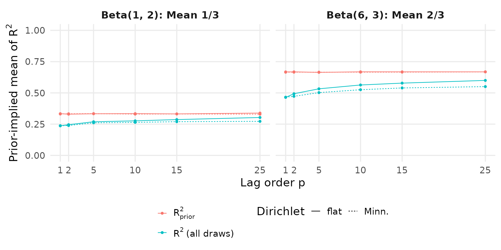
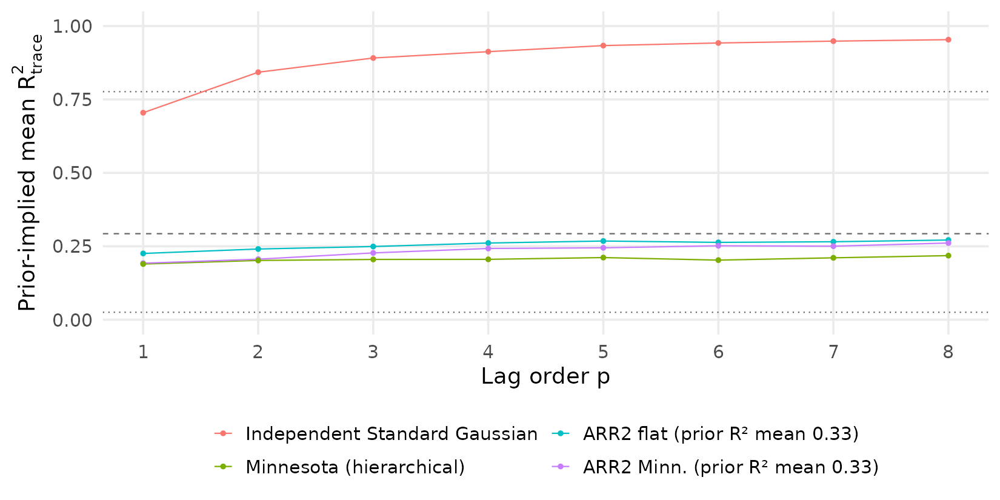
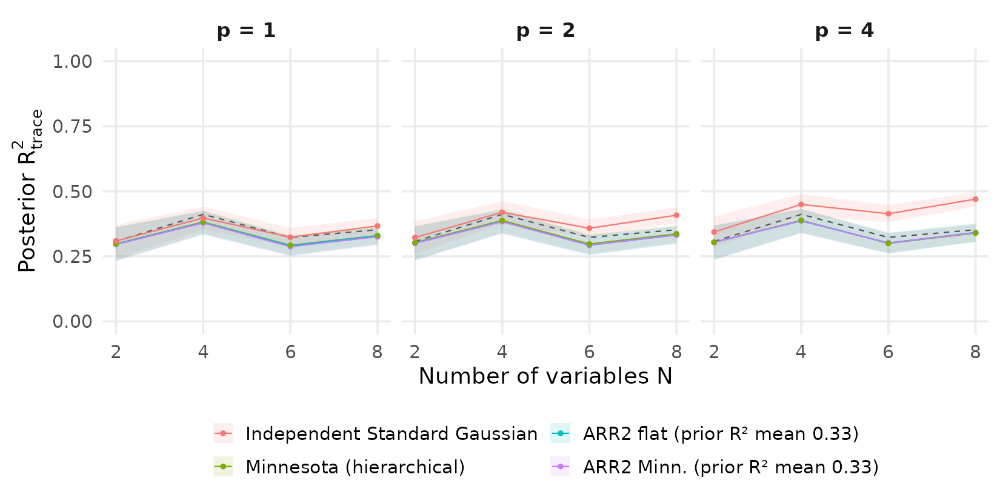
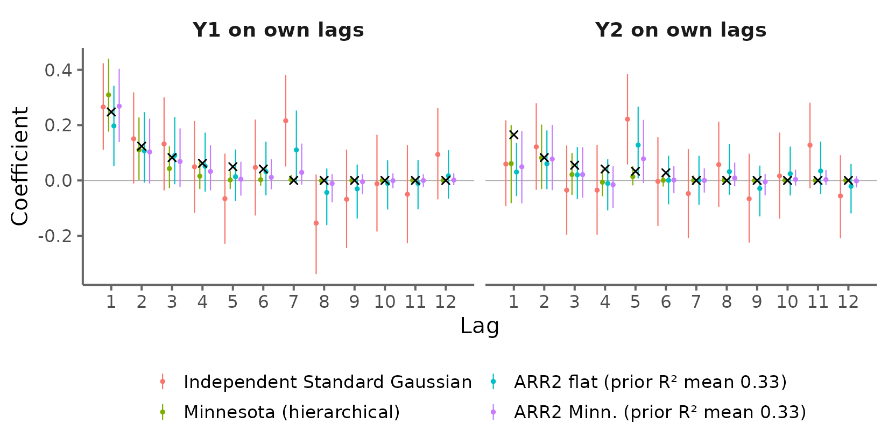
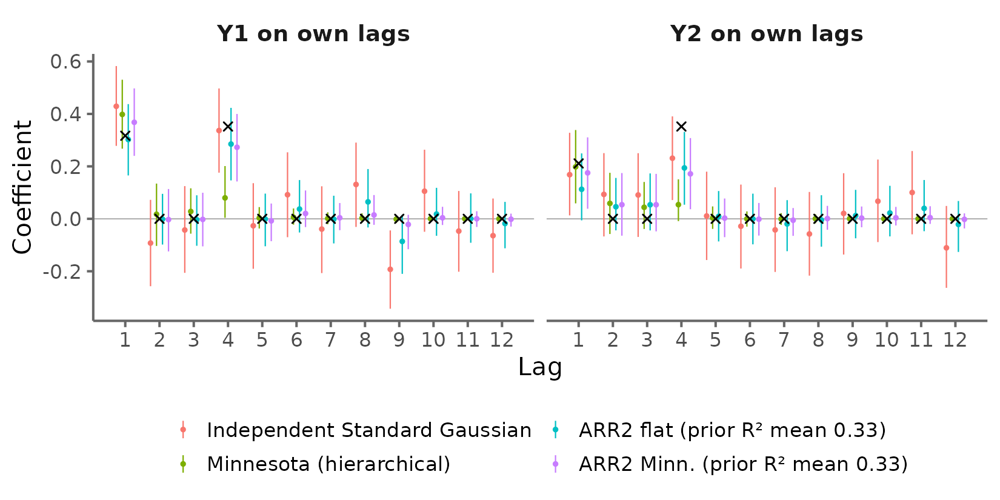
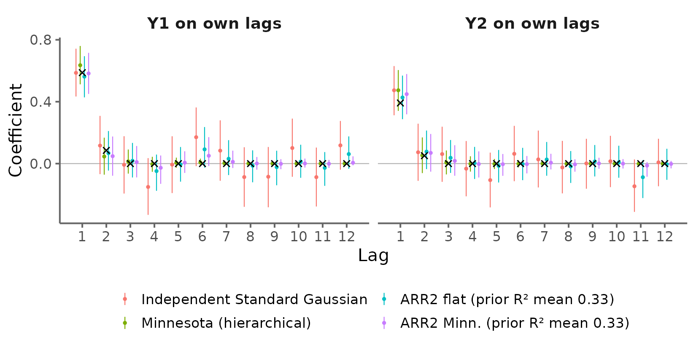

# AR and VAR models {background-color="#9E7E38"}

## Autoregressions

An AR($p$) model for a single series:

$$
y_t = \sum_{i=1}^{p} \phi_i\, y_{t-i} + \varepsilon_t, \qquad \varepsilon_t \sim N(0, \sigma^2)
$$

- The value of the series at time $t$ is a linear function of the last $p$ values of the series plus a shock, $\varepsilon_t$.

## Vector autoregressions

A VAR($p$) for $N$ series:

$$
\mathbf{y}_t = \sum_{i=1}^{p} \mathbf{A}_i\, \mathbf{y}_{t-i} + \mathbf{u}_t, \qquad \mathbf{u}_t \sim N(\mathbf{0}, \Sigma)
$$

- Each $\mathbf{A}_i$ is $N \times N$, so every series depends on the past values of every series.
- The number of coefficients grows quadratically as $N$ increases (there are $N^2 p$ coefficients). With $N = 8$ and $p = 4$, we already have 256 coefficients.
- Time series (in macroeconomics, social science data) often have low series length, so shrinkage is necessary for stable coefficient estimates.

# What is R^2^ in a time series? {background-color="#9E7E38"}

## Bayesian R^2^

From [@gelman2019r2], we have a notion of R^2^ where a model can be split (generally) into systematic and random components. In the case of an AR($p$) model:

$$
y_t \;=\; \underbrace{\sum_{i=1}^{p} \phi_i\, y_{t-i}}_{\textstyle \mu_t \;\text{(systematic)}}
\;+\; \underbrace{\varepsilon_t}_{\textstyle \text{random}} \qquad \varepsilon_t \sim N(0, \sigma^2)
$$

Then taking the ratio, which can be calculated per posterior (or prior) draw:

$$
R^2 = \frac{\operatorname{Var}(\mu_{t})}{\operatorname{Var}(\mu_{t}) + \sigma^2}
$$

This gives a full distribution for R^2^. From here on, $R^2$ uses this definition.

# Bayesian VARs {background-color="#9E7E38"}

## Bayesian VARs

Writing out a two-equation, VAR(2):

$$
\begin{bmatrix} y_{1,t} \\ y_{2,t} \end{bmatrix}
=
\begin{bmatrix} a^{(1)}_{11} & a^{(1)}_{12} \\ a^{(1)}_{21} & a^{(1)}_{22} \end{bmatrix}
\begin{bmatrix} y_{1,t-1} \\ y_{2,t-1} \end{bmatrix}
+
\begin{bmatrix} a^{(2)}_{11} & a^{(2)}_{12} \\ a^{(2)}_{21} & a^{(2)}_{22} \end{bmatrix}
\begin{bmatrix} y_{1,t-2} \\ y_{2,t-2} \end{bmatrix}
+
\begin{bmatrix} u_{1,t} \\ u_{2,t} \end{bmatrix},
\qquad
\begin{bmatrix} u_{1,t} \\ u_{2,t} \end{bmatrix} \sim N\!\left(\mathbf{0},\;
\begin{bmatrix} \sigma_1^2 & \sigma_{12} \\ \sigma_{12} & \sigma_2^2 \end{bmatrix}\right)
$$

- We need to specify prior distributions for coefficient and innovation covariance matrices
- There are many ways to do this!

## Two common priors

**Independent Gaussian:** $a^{(i)}_{nk}$ for every coefficient.

**Minnesota:** Informative prior first introduced in the 1980s [@litterman1986] using heuristic plug-ins, and eventually parameterized with hyperpriors as in @giannone2015prior and @chan2021minnesota:

$$
a^{(i)}_{nn}\sim N \left(0, \frac{\lambda}{i^{d}}\right)\ \qquad
a^{(i)}_{ng}\sim N \left(0, \frac{\lambda\,\theta}{i^{d}}\right) \quad (g \ne n)
$$

- $\lambda$: overall tightness
- $\theta$: cross-variable tightness
- $d$: lag decay

The Minnesota prior is designed to put greater prior mass on own-lag and lower-lag coefficients (that is, the series is similar to a random walk).

# R2D2 and ARR2 {background-color="#9E7E38"}

## R2D2: A prior on model fit

First parameterized for linear regression [@zhang2022r2d2]:

$\operatorname{Var}(\mu_i)$ can (by conditional independence and assuming coefficient prior mean of 0) be written as $\sum\operatorname{Var}(x_j)\operatorname{Var}(\beta_j)$, so we can set the coefficient prior variances equal to a constant $c$ times the components of a Dirichlet vector, to reduce the sum:

$$
\operatorname{Var}(\mu_i) = \sum_{j=1}^n \operatorname{Var}(x_j)\operatorname{Var}(\beta_j) = \sum_{j=1}^n \operatorname{Var}(x_j)\ c\ \psi_j = c \sum_{j=1}^n \operatorname{Var}(x_j)
$$

and letting $c = \frac{\sigma^2}{\sum\operatorname{Var}(x_j)}\tau^2$, and plugging into a representation of $R^2$:

$$
R^2 = \frac{\sum_{j=1}^n \operatorname{Var}(x_j)\operatorname{Var}(\beta_j)}{\sum_{j=1}^n \operatorname{Var}(x_j)\operatorname{Var}(\beta_j) + \sigma^2} = \frac{\tau^2}{\tau^2 + 1}.
$$

This induces the following prior on each $\beta_j$:

$$
\beta_j \sim N\!\left(0,\; \frac{\sigma^2}{\operatorname{Var}(x_j)}\,\tau^2\,\psi_j\right)
$$

## R2D2: A prior on model fit

The full prior is:

$$
\begin{aligned}
y_i &\sim N\!\left(\alpha + \mathbf{x}_i^\top \boldsymbol\beta,\; \sigma^2\right) \\[4pt]
\beta_j &\sim N\!\left(0,\; \frac{\sigma^2}{\operatorname{Var}(x_j)}\,\tau^2\,\psi_j\right)\\[4pt]
\boldsymbol\psi &\sim \operatorname{Dir}(\xi_1, \dots, \xi_p) \\[4pt]
\tau^2 &= \frac{R^2_{\text{prior}}}{1 - R^2_{\text{prior}}} \\[4pt]
R^2_{\text{prior}} &\sim \operatorname{Beta}\!\left(\mu_{R^2}, \varphi_{R^2}\right) \\[4pt]
\sigma &\sim \pi(\sigma)\\[4pt]
\alpha &\sim \pi(\alpha)\\[4pt]
\end{aligned}
$$

- A global variance "knob" ($R^2_{\text{prior}}$) is allocated across the prior, and total prior explained variance remains consistent as the model expands. @riha2026select uses R2D2 as an example when formalizing this idea.
- R2D2 has since been extended to multilevel models [@aguilar2023r2d2m2], generalized linear mixed models [@yanchenko2025r2d2glmm] and autoregressions [@kohns2025arr2].

## ARR2: R2D2 for autoregressions

@kohns2025arr2 extends this construction to different classes of AR models:

$$
\begin{aligned}
y_t &\sim N\!\left(\sum_{i=1}^{p} \phi_i\, y_{t-i},\; \sigma^2\right) \\[4pt]
\phi_i &\sim N\!\left(0,\; \frac{\sigma^2}{\hat\sigma^2_{y_t}}\,\tau^2\,\psi_i\right)\\[4pt]
\boldsymbol\psi &\sim \operatorname{Dir}(\xi_1, \dots, \xi_p) \\[4pt]
\tau^2 &= \frac{R^2_{\text{prior}}}{1 - R^2_{\text{prior}}} \\[4pt]
R^2_{\text{prior}} &\sim \operatorname{Beta}\!\left(\mu_{R^2}, \varphi_{R^2}\right) \\[4pt]
\sigma &\sim \pi(\sigma)\\[4pt]
\end{aligned}
$$

- Concentrations $\xi$ can be set to induce variance allocation as desired (flat, Minnesota-like, etc.).
- $\hat\sigma^2_{y_t}$ is a plug-in variance used to resolve mathematical and computational complexity.
- The prior assumes the series is stationary, but does not enforce it; @heaps2023stationarity gives a VAR parameterization that does.

# ARR2 in the AR case {background-color="#9E7E38"}

## What does $R^2_{\text{prior}}$ control?

To examine the properties of the prior, we can consider R^2^ under the prior predictive distribution. From the prior derivation, we have

$$
E_{\mathbf{\phi}}\!\left[\operatorname{Var}(\mu_t)\right] \approx \sigma^2\tau^2.
$$

Substituting the expected value into our definition of R^2^, it follows

$$
\frac{E_\mathbf{\phi}\!\left[\operatorname{Var}(\mu_t)\right]}{E_\mathbf{\phi}\!\left[\operatorname{Var}(\mu_t)\right] + \sigma^2} \approx \frac{\tau^2}{1 + \tau^2} = R^2_{\text{prior}}
$$

That is, the prior is controlling $R^2$ after integrating out the autoregressive coefficients in $\operatorname{Var}(\mu_t)$. However, taking $E_\mathbf{\phi}\![R^2]$. Instead, we have

$$
E_\mathbf{\phi}\ \![R^2] = E_\mathbf{\phi}\!\left[\frac{\operatorname{Var}(\mu_{t})}{\operatorname{Var}(\mu_{t}) + \sigma^2}\right]
\leq \frac{E_\mathbf{\phi}\!\left[\operatorname{Var}(\mu_t)\right]}{E_\mathbf{\phi}\!\left[\operatorname{Var}(\mu_t)\right] + \sigma^2}
\approx R^2_{\text{prior}}
$$
by Jensen's inequality.

## AR results: Implied Prior R^2^

This is demonstrated in simulation:

{fig-alt="Prior means of R² prior, implied process R² and R² by lag order" fig-align="center" width="85%"}

# Extending ARR2 to VARs {background-color="#9E7E38"}

## Why a trace R^2^?

ARR2's supplementary VAR extension places an $R^2_{\text{prior}}$ on each equation separately:

- Each equation's fit is controlled, but adding variables adds equations, and with them more total prior variance.
- The equations are set up recursively, so the prior depends on how the variables are ordered.

We use trace R^2^ to summarize total fit for the whole system under a reduced-form VAR:

$$
R^2_{\text{trace}} = \frac{\sum_n \operatorname{Var}(\mu_{n,t})}{\sum_n \operatorname{Var}(\mu_{n,t}) + \operatorname{tr}(\Sigma)}
= \sum_n w_n R^2_n
$$
- can be interpreted as a weighted sum of equation-level R^2^
-A single $R^2_{\text{prior}}$ sets the system-level total variance (as summarized by $R^2_{\text{trace}}$), and Dirichlet weights split it across equations, lags, and cross terms.
- The trace is linear, so the R2D2 and ARR2 arguments carry over directly: $E\!\left[\sum_n \operatorname{Var}(\mu_{n,t})\right] = \operatorname{tr}(\Sigma)\,\tau^2$.

## A trace R² prior for VARs

The trace R^2^ version is as follows:

$$
\begin{aligned}
\mathbf{y}_t &\sim N\!\left(\sum_{i=1}^{p} \mathbf{A}_i\, \mathbf{y}_{t-i},\; \Sigma\right), \qquad [\mathbf{A}_i]_{nn} = \phi_{n,i}, \quad [\mathbf{A}_i]_{ng} = \beta_{n,i,g} \;\; (g \ne n) \\[4pt]
\phi_{n,i} &\sim N\!\left(0,\; \frac{\operatorname{tr}(\Sigma)}{\operatorname{Var}(y_{n,t})}\,\tau^2\,w_1\,\psi_{n,i}\right)\\[4pt]
\beta_{n,i,g} &\sim N\!\left(0,\; \frac{\operatorname{tr}(\Sigma)}{\operatorname{Var}(y_{g,t})}\,\tau^2\,w_2\,\gamma_{n,i,g}\right)\\[4pt]
\mathbf{w} &\sim \operatorname{Dir}(\xi_{\text{split}}), \qquad \boldsymbol\psi \sim \operatorname{Dir}(\boldsymbol\xi_{\text{own}}), \qquad \boldsymbol\gamma \sim \operatorname{Dir}(\boldsymbol\xi_{\text{cross}}) \\[4pt]
\tau^2 &= \frac{R^2_{\text{prior}}}{1 - R^2_{\text{prior}}} \\[4pt]
R^2_{\text{prior}} &\sim \operatorname{Beta}\!\left(\mu_{R^2}, \varphi_{R^2}\right) \\[4pt]
\Sigma &\sim \pi(\Sigma)\\[4pt]
\end{aligned}
$$

## Simulation design

## Prior fit as lags are added

{fig-alt="Prior-implied R² by lag order" fig-align="center" width="72%"}

Prior-implied $R^2_{\text{trace}}$ for a two-variable VAR as the lag order grows.^[Simulations run in Stan.]

## Prior fit as variables are added

{fig-alt="Prior-implied R² by number of variables" fig-align="center" width="78%"}

Prior-implied $R^2_{\text{trace}}$ as variables are added, at $p = 1, 2, 4$.^[Simulations run in Stan.]

## Posterior fit as variables are added

{fig-alt="Posterior R² by number of variables" fig-align="center" width="78%"}

Posterior $R^2_{\text{trace}}$ against the true value (dashed) as variables are added.^[Simulations run in Stan.]

## Posterior coefficients by lag

Fitted with $p = 12$ to four true lag structures: posterior mean and 90% interval; × marks the true value.^[Simulations run in Stan.]

::: {.panel-tabset}

### Baseline VAR(2)

{fig-alt="Posterior coefficients by lag, baseline VAR(2)" fig-align="center" width="55%"}

### Long decay (VAR(6))

{fig-alt="Posterior coefficients by lag, long-decay VAR(6)" fig-align="center" width="55%"}

### Sparse (lags 1 and 4)

{fig-alt="Posterior coefficients by lag, sparse lags 1 and 4" fig-align="center" width="55%"}

### Near unit root

{fig-alt="Posterior coefficients by lag, near unit root" fig-align="center" width="55%"}

:::

## References

::: {#refs}
:::
