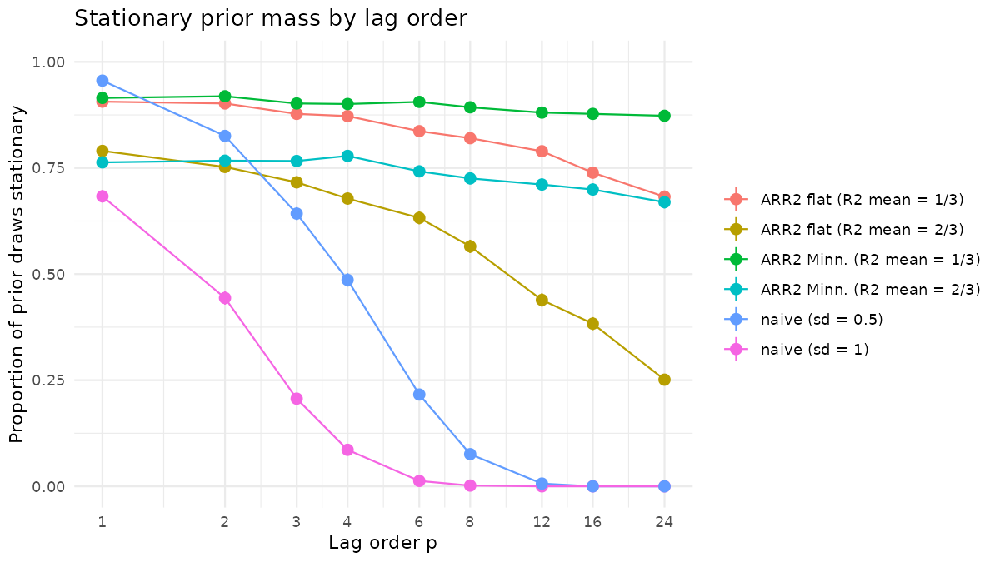
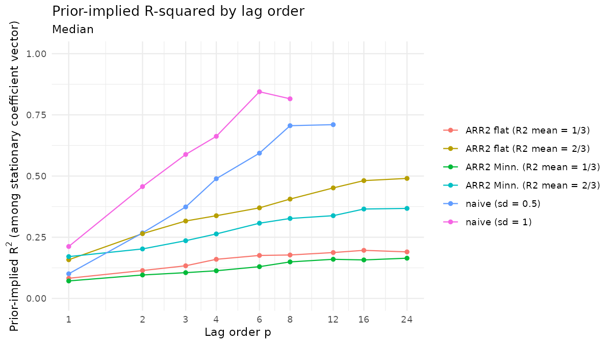
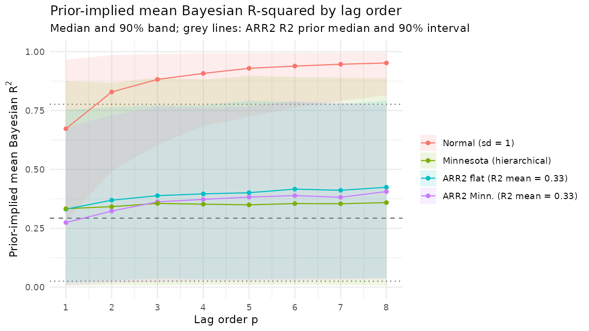
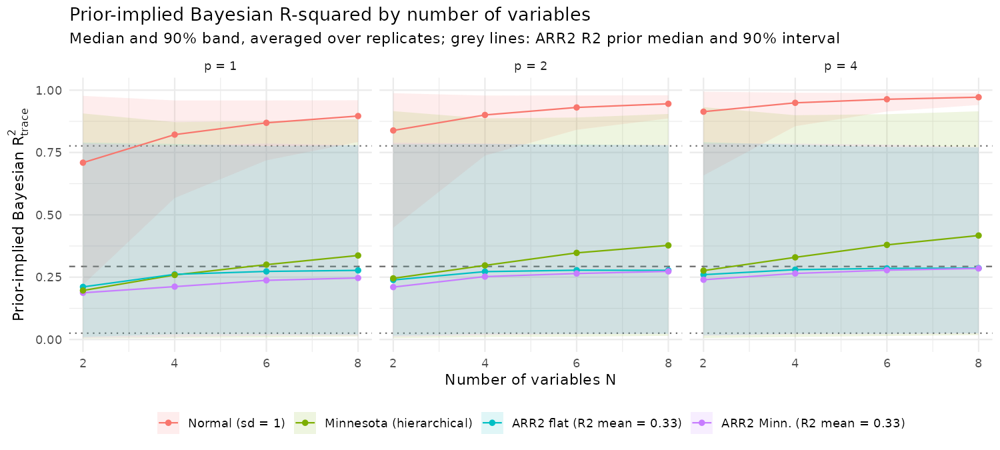

## Outline

1. AR and VAR models
2. What is R^2^ in a time series?
3. Bayesian VARs and and common priors
4. R2D2 and the ARR2 prior
5. ARR2 for AR models
6. Extending ARR2 to VARs
7. Future work

# AR and VAR models {background-color="#9E7E38"}

## Autoregressions

An AR($p$) model for a single series:

$$
y_t = c + \sum_{i=1}^{p} \phi_i\, y_{t-i} + \varepsilon_t, \qquad \varepsilon_t \sim N(0, \sigma^2)
$$

- The value of the series at time $t$ is a linear function of the last $p$ values of the series plus a shock, $\varepsilon_t$.
- The AR process is said to be stationary when the statistical properties (mean, variance, etc.) remain the same across time.
- This is true when the roots of the  characteristic polynomial, $1 - \phi_1 z - \ldots - \phi_p z^p$, lie outside the unit circle.
- Time series analysis almost always assumes a stationary series.

## Vector autoregressions

A VAR($p$) for $N$ series:

$$
\mathbf{y}_t = \mathbf{c} + \sum_{i=1}^{p} \mathbf{A}_i\, \mathbf{y}_{t-i} + \mathbf{u}_t, \qquad \mathbf{u}_t \sim N(\mathbf{0}, \Sigma)
$$

- A multivariate extension of an AR(p) process.
- Each $\mathbf{A}_i$ is $N \times N$, so every series depends on the past values of every series.
- The number of coefficients grows quadratically as $N$ increase (there are $N^2 p$ coefficients). With $N = 8$ and $p = 4$, we already have 256 coefficients.
- Time series (in macroeconomics, social science data) often have low series length, so shrinkage is necessary for stable coefficient estimates.

# What is R^2^ in a time series? {background-color="#9E7E38"}

## Implied process R^2^

Consider a known stationary $AR(p)$ process; it has an implied process R^2^, written $R^2_{\text{proc}}$. From Yule-Walker, we have 

$$\gamma_0 = \sum^p_{i=1} \phi_i\gamma_i + \sigma^2,$$

where $\gamma_i$ is the $i$th autocovariance and $\gamma_0$ is derived process variance. Dividing by $\gamma_0$ and rearranging gives

\begin{align*}
  R^2_{\text{proc}} &= 1 - \frac{\sigma^2}{\gamma_0} \\
  &= \sum^p_{i=1}\phi_i\rho_i.
\end{align*}

So, given the coefficients of an AR(p) process, we have an implied process R^2^, $R^2_{\text{proc}}$.

## Bayesian R^2^

We also have a notion of Bayesian R^2^ [@gelman2019r2], which can be calculated per posterior (or prior) draw:

$$
R^2 = \frac{\operatorname{Var}(\hat\mu_{t})}{\operatorname{Var}(\hat\mu_{t}) + \sigma^2}, \qquad \hat\mu_t = \sum_{i=1}^p \phi_i\, y_{t-i}
$$

This gives a full distribution for R^2^. From here on, $R^2$ without a subscript means this Bayesian R^2^.

# Bayesian VARs {background-color="#9E7E38"}

## The usual priors

**Independent Gaussian:** $A_{i,nk} \sim N(0, \sigma^2)$ for every coefficient.

**Minnesota:** First introduced in the 1980s [@litterman1986] using heuristic plug-ins, and eventually parameterized with hyperpriors as in @giannone2015prior and @chan2021minnesota:

$$
A_{i,nn}\sim N \left(0, \frac{\lambda}{i^{d}}\right) \qquad
A_{i,ng}\sim N \left(0, \frac{\lambda\,\theta}{i^{d}}\cdot\frac{s_n}{s_g}\right) \quad (g \ne n)
$$

- $\lambda$: overall tightness, Gamma prior (mode 0.2, sd 0.4)
- $\theta$: cross-variable tightness, Beta(2, 2)
- $d$: lag decay, Gamma prior (mode 1, sd 0.5)

# R2D2 and ARR2 {background-color="#9E7E38"}

## R2D2: A prior on model fit

First parameterized for linear regression [@zhang2022r2d2]:

- A Beta prior is set on a fit parameter, $R^2_{\text{prior}}$.
- The ratio $\tau^2 = R^2_{\text{prior}}/(1 - R^2_{\text{prior}})$ is split across coefficients with a Dirichlet simplex $\psi$:

$$
\beta_j \sim N\!\left(0,\; \frac{\sigma^2}{s_{x_j}^2}\,\tau^2\,\psi_j\right), \qquad \psi \sim \operatorname{Dir}(\xi)
$$

- So, a global variance "knob" ($R^2_{\text{prior}}$) is allocated across the prior, and total prior explained variance remains consistent as the model expands. @riha2026select uses R2D2 as an example when formalizing this idea.

## ARR2: R2D2 for autoregressions

@kohns2025arr2 extends this construction to different classes of AR models:

$$
\phi_i \sim N\!\left(0,\; \frac{\sigma^2}{\operatorname{var}(y_t)}\,\tau^2\,\psi_i\right), \quad
\tau^2 = \frac{R^2_{\text{prior}}}{1 - R^2_{\text{prior}}}, \quad
R^2_{\text{prior}} \sim \operatorname{Beta}, \quad
\psi \sim \operatorname{Dir}(\xi_1, \dots, \xi_p)
$$

- Concentrations $\xi$ can be set to induce variance allocation as desired (flat, Minnesota-like, etc.).
- $\operatorname{var}(y_t)$ is a plug-in variance used to resolve mathematical and computational complexity.
- The prior assumes the series is stationary, but does not enforce it.

# ARR2 in the AR case {background-color="#9E7E38"}

## What does $R^2_{\text{prior}}$ control?

To examine the properties of the prior, we can consider R^2^ under the prior predictive distribution, so we have

$$\operatorname{Var}(\mu_t) = \mathbf{\phi}^\top\hat{\Gamma}\mathbf{\phi},$$

where $\hat{\Gamma}$ is the sample autocovariance matrix.

After some rearrangement, we can show that integrating over the coefficients $\mathbf{\phi}$ gives us,

$$
E_{\mathbf{\phi}}\!\left[\operatorname{Var}(\mu_t)\right] \approx \sigma^2\tau^2.
$$

Substituting the expected value into our definition of R^2^, it follows

$$
\frac{E_\mathbf{\phi}\!\left[\operatorname{Var}(\mu_t)\right]}{E_\mathbf{\phi}\!\left[\operatorname{Var}(\mu_t)\right] + \sigma^2} \approx \frac{\tau^2}{1 + \tau^2} = R^2_{\text{prior}}
$$

That is, the prior is controlling $R^2$ after integrating out the autoregressive coefficients in $\operatorname{Var}(\mu_t)$.

## What does $R^2_{\text{prior}}$ control?

However, taking $E_\mathbf{\phi}\![R^2 \mid \tau^2, \psi, \sigma^2]$ does not lend the same equality. We have, $R^2 = \frac{\mathbf{\phi}^\top\hat{\Gamma}\mathbf{\phi}}{\mathbf{\phi}^\top\hat{\Gamma}\mathbf{\phi} + \sigma^2}$, so $R^2 = g(\mathbf{\phi}^\top\hat{\Gamma}\mathbf{\phi})$ where $g$ is a concave function. Then,

\begin{align*}
E_\mathbf{\phi}\![R^2 \mid \tau^2, \psi, \sigma^2] &= E_\mathbf{\phi}\![g(\mathbf{\phi}^\top\hat{\Gamma}\mathbf{\phi}) \mid \tau^2, \psi, \sigma^2] \\ 
&\leq g\left(E_\mathbf{\phi}\![\mathbf{\phi}^\top\hat{\Gamma}\mathbf{\phi} \mid \tau^2, \psi, \sigma^2]\right) \\
&\approx R^2_{\text{prior}},
\end{align*}

where the inequality holds due to Jensen's inequality. So, $E_\mathbf{\phi}\![R^2 \mid \tau^2, \psi, \sigma^2]\leq R^2_\text{prior}$. 

## AR results: Stationarity

{fig-alt="Share of prior draws that are stationary, by lag order" fig-align="center" width="85%"}

- Naive priors lose stationarity fast as $p$ grows; ARR2 keeps most draws stationary.

::: notes
Walk through one line on each panel. [Fill in the key numbers from the figures, e.g. "with sd = 1, stationary share drops from 0.68 at p = 1 to about 0 by p = 8".]{.todo}
:::

## AR results: implied fit

{fig-alt="Prior-implied process R² and Bayesian R² by lag order" fig-align="center" width="85%"}

- Left: $R^2_{\text{proc}}$ (stationary draws). Right: $R^2$ (all draws). Dotted: median of $R^2_{\text{prior}}$.
- [Takeaway: ARR2's $R^2$ sits just below $R^2_{\text{prior}}$ (Jensen); $R^2_{\text{proc}}$ sits further below]{.todo}

# Extending ARR2 to VARs {background-color="#9E7E38"}

## A trace R² prior for VARs

Own lags $\phi_{n,i}$ and cross lags $\beta_{n,i,g}$ share one fit budget:

$$
\phi_{n,i} \sim N\!\left(0,\; \frac{\operatorname{tr}\Sigma}{s_n^2}\,\tau^2\,\psi_{n,i}\right), \qquad
\beta_{n,i,g} \sim N\!\left(0,\; \frac{\operatorname{tr}\Sigma}{s_g^2}\,\tau^2\,\gamma_{n,i,g}\right)
$$

$$
\psi = w_1 \tilde\psi, \quad \gamma = w_2 \tilde\gamma, \quad w \sim \operatorname{Dir}(\xi_{\text{split}}), \quad
\tau^2 = \frac{R^2_{\text{prior}}}{1-R^2_{\text{prior}}}
$$

- Same argument as the AR case: $E_z[\sum_k v_k] = \operatorname{tr}\Sigma\,\tau^2$, so $R^2_{\text{prior}}$ targets the marginal $R^2_{\text{trace}}$.
- Order-invariant: does not depend on how the variables are ordered.

::: notes
Contrast with ARR2's own VAR extension, which works equation by equation and has no system-level target.
:::

## Simulation design

::: {style="font-size: 0.85em"}
| Sweep | True model | Varies | Modes | Datasets |
|---|---|---|---|---|
| 01 | Baseline VAR(2), N = 2 | p = 1–8 | prior, fit | 1 |
| 02 | 4 lag structures, N = 2 | p = 1–12 | fit | 1 |
| 03 | 4 independent 2-variable blocks | N = 2, 4, 6, 8; p = 1, 2, 4 | prior, fit | 3 |

: {tbl-colwidths="[8,34,30,16,12]"}
:::

- Priors compared: independent normal (sd 1), hierarchical Minnesota, ARR2 flat, ARR2 Minnesota-style concentrations ($R^2_{\text{prior}}$ mean 1/3).
- $T = 150$ standardized observations; Stan, 4 chains × 1000 draws.
- All summaries are of $R^2$ (Bayesian), mostly its trace version $R^2_{\text{trace}}$.

::: notes
Sweep 02's lag structures: baseline VAR(2), long decaying lags (VAR(6)), sparse (lags 1 and 4 only), near unit root.
:::

## Sweep 01: stationarity as lags are added

{fig-alt="Stationary share of prior draws by lag order" fig-align="center" width="85%"}

- [Key takeaway from the stationarity figure]{.todo}

## Sweep 01: implied fit as lags are added

{fig-alt="Prior-implied Bayesian R² by lag order" fig-align="center" width="85%"}

- [Key takeaway, e.g. "ARR2 stays flat in p; the normal prior's implied fit rises toward 1"]{.todo}

## Sweep 02: posterior fit vs. lag order

{fig-alt="Posterior Bayesian R² by lag order, for each true lag structure" fig-align="center" width="90%"}

- [Normal prior: posterior R² inflates as spurious lags are added]{.todo}
- [ARR2 and Minnesota: roughly flat in p, near the true value]{.todo}

## Sweep 02: where the coefficients go wrong

{fig-alt="Coefficient RMSE against the truth" fig-align="center" width="85%"}

- [Takeaway on true-zero (spurious) coefficients]{.todo}
- [Takeaway on the sparse structure (lag 4)]{.todo}

## Sweep 03: adding variables

- True model: 4 independent copies of the baseline VAR(2), with block $R^2_{\text{proc}}$ of 0.30, 0.60, 0.15 and 0.45.
- Fit the first $N = 2, 4, 6, 8$ series: each subset is itself a VAR(2), so the truth is known exactly.
- All cross-block coefficients are truly zero.

::: notes
Example: "This design is easy to explain: adding a block adds variables without changing what the earlier variables should explain."
:::

## Sweep 03: prior fit as variables are added

{fig-alt="Prior-implied Bayesian R² by number of variables" fig-align="center" width="95%"}

- Minnesota: median prior $R^2_{\text{trace}}$ rises from about 0.20 to 0.42 across $N$ and $p$.
- ARR2: stays between about 0.19 and 0.29, approaching the median of $R^2_{\text{prior}}$ (dashed) from below as the Jensen gap shrinks.
- Normal: near 1 throughout.

::: notes
Framing: "Minnesota was not designed to control R², so this is not a criticism of it. The point is that its implied prior on fit changes meaning as you add variables or lags; ARR2's does not."
:::

## Sweep 03: posterior fit

{fig-alt="Posterior Bayesian R² by number of variables" fig-align="center" width="95%"}

- With $T = 150$, the data pin down total fit for ARR2 and Minnesota.
- [Where the normal prior sits relative to the true line]{.todo}

## Sweep 03: coefficient accuracy

{fig-alt="Coefficient RMSE against the truth by number of variables" fig-align="center" width="90%"}

- ARR2 (Minnesota concentrations) is best or tied on both true-zero and nonzero coefficients at $p \ge 2$.
- True-zero RMSE falls with $N$ for ARR2 and Minnesota: more coefficients share a fixed budget.
- ARR2 flat over-shrinks the true lags at $p = 4$: the split of the budget matters.

::: notes
Scale: at N = 8, p = 4 there are 224 true-zero coefficients; total squared error is about 2.2 under the normal prior vs 0.11 under ARR2 Minn.
:::

## Caveats

- Preliminary: 1–3 simulated datasets per cell; Monte Carlo standard errors not yet reported.
- ARR2 with Minnesota-style concentrations has ~7% divergent transitions at large $N p$ (small Dirichlet concentrations); a reparameterization is planned.
- Simulated data only so far.

# Future work {background-color="#9E7E38"}

## Next steps

- **Empirical work:** a sentiment VAR (UMich / NY Fed SCE with unemployment, inflation, real wages).
- **Structural comparison:** compare the trace prior with the equation-wise structural ARR2 in the supplement of @kohns2025arr2.
- **Unequal fit across series:** experiments where R² differs widely across equations, where trace and mean R² diverge.
- [Other items: determinant-R² prior; priors on variance decompositions; more replicates; LFO-CV]{.todo}

::: notes
[Timeline to the March 15 draft]{.todo}
:::

## References

::: {#refs}
:::

# Backup slides {visibility="uncounted" background-color="#9E7E38"}

## Why be Bayesian here? {visibility="uncounted"}

- A prior on fit is a stated belief that can be checked by prior predictive simulation and carried across $N$ and $p$; a tuned penalty is not.
- Hierarchical priors learn hundreds of local scales at once; cross-validation can tune one or two.
- Posterior uncertainty propagates coherently to impulse responses and variance decompositions, including hyperparameter uncertainty.
- Structural objects (sign restrictions, priors on variance decompositions) are naturally Bayesian.

::: notes
Concede: for point forecasts alone, well-tuned frequentist shrinkage (ridge with a CV-chosen penalty) is often competitive.
:::
