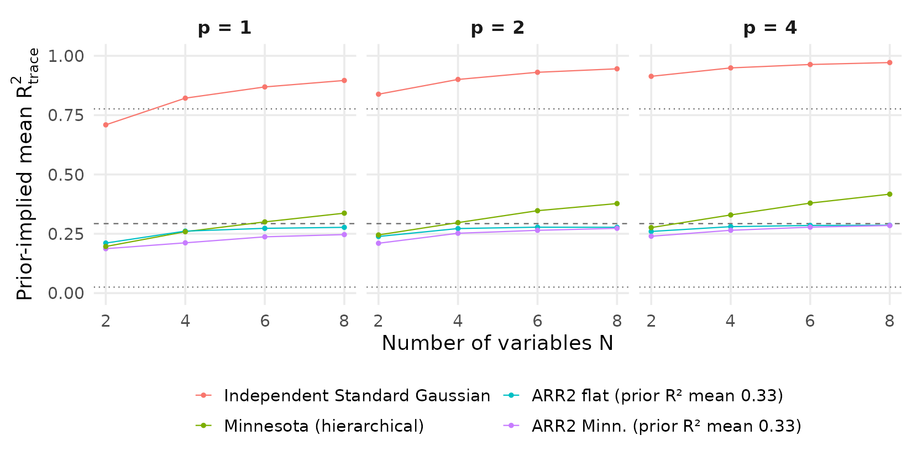
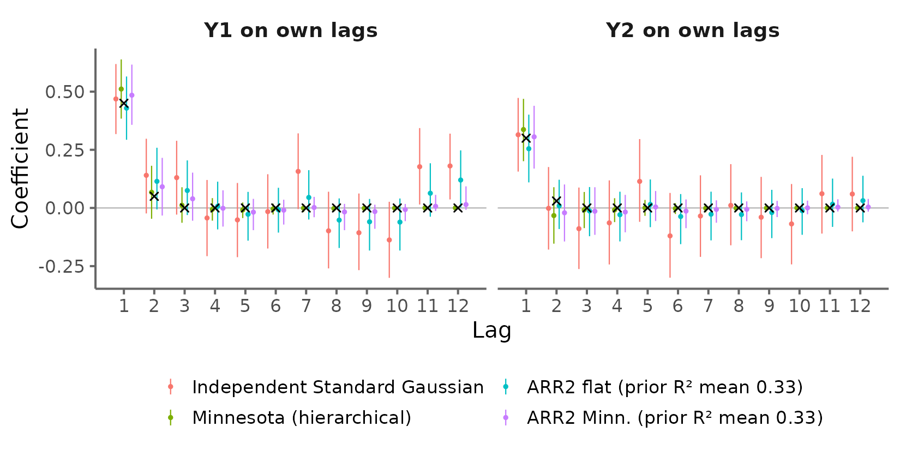

## Autoregressions {section-label="AR and VAR models"}

An AR($p$) model for a single series:

$$
\Large
y_t = \sum_{i=1}^{p} \phi_i\, y_{t-i} + \varepsilon_t, \qquad \varepsilon_t \sim N(0, \sigma^2)
$$

- The value of the series at time $t$ is a linear function of the last $p$ values of the series plus a shock, $\varepsilon_t$.
- We assume that the process is stationary.

## Vector autoregressions {section-label="AR and VAR models"}

A VAR($p$) for $N$ series:

$$
\Large
\mathbf{y}_t = \sum_{i=1}^{p} \mathbf{A}_i\, \mathbf{y}_{t-i} + \mathbf{u}_t, \qquad \mathbf{u}_t \sim N(\mathbf{0}, \Sigma)
$$

- Each $\mathbf{A}_i$ is $N \times N$, so every series depends on the past values of every series.
- The number of coefficients grows quadratically as $N$ increases (there are $N^2 p$ coefficients). With $N = 8$ and $p = 4$, we already have 256 coefficients.
- Time series (in macroeconomics, social science data) often have low series length, so shrinkage is necessary for stable coefficient estimates.

## Bayesian $R^2$ {section-label="R² in time series"}

:::{.fragment}  

From @gelman2019r2, we have a notion of $R^2$ where a model can be split (generally) into systematic and random components. In the case of an AR($p$) model:

$$
y_t \;=\; \underbrace{\sum_{i=1}^{p} \phi_i\, y_{t-i}}_{\textstyle \mu_t \;\text{(systematic)}}
\;+\; \underbrace{\varepsilon_t}_{\textstyle \text{random}} \qquad \varepsilon_t \sim N(0, \sigma^2)
$$

:::

:::{.fragment}

Then taking the ratio, which can be taken over the posterior (or prior):

$$
R^2 = \frac{\operatorname{Var}(\mu_{t})}{\operatorname{Var}(\mu_{t}) + \sigma^2}.
$$

This gives a full distribution for $R^2$.

:::

## Bayesian VARs {section-label="Bayesian VARs"}

Writing out a two-equation, VAR(2):

$$
\begin{bmatrix} y_{1,t} \\ y_{2,t} \end{bmatrix}
=
\begin{bmatrix} a^{(1)}_{11} & a^{(1)}_{12} \\ a^{(1)}_{21} & a^{(1)}_{22} \end{bmatrix}
\begin{bmatrix} y_{1,t-1} \\ y_{2,t-1} \end{bmatrix}
+
\begin{bmatrix} a^{(2)}_{11} & a^{(2)}_{12} \\ a^{(2)}_{21} & a^{(2)}_{22} \end{bmatrix}
\begin{bmatrix} y_{1,t-2} \\ y_{2,t-2} \end{bmatrix}
+
\begin{bmatrix} u_{1,t} \\ u_{2,t} \end{bmatrix},
\qquad
\begin{bmatrix} u_{1,t} \\ u_{2,t} \end{bmatrix} \sim N\!\left(\mathbf{0},\;
\begin{bmatrix} \sigma_1^2 & \sigma_{12} \\ \sigma_{12} & \sigma_2^2 \end{bmatrix}\right)
$$

- We need to specify a distribution for the likelihood, and prior distributions for coefficient and shock covariance matrices.
- There are many ways to do this!

## Two common priors {section-label="Bayesian VARs"}

:::{.fragment}

**Independent Gaussian:** $a^{(i)}_{nk}\sim N (0, \sigma^2)$ for every coefficient.

:::
:::{.fragment}

**Minnesota:** Informative prior first introduced in the 1980s [@litterman1986] using heuristic plug-ins, and eventually parameterized with hyperpriors as in @giannone2015prior and @chan2021minnesota:

$$
a^{(i)}_{nn}\sim N \left(0, \left(\frac{\lambda}{i^{d}}\right)^{2}\right) \qquad
a^{(i)}_{ng}\sim N \left(0, \left(\frac{\lambda\,\theta}{i^{d}}\right)^{2}\right) \quad (g \ne n)
$$

- $\lambda$: overall tightness
- $\theta$: cross-variable tightness
- $d$: lag decay

The Minnesota prior is designed to put greater prior mass on own-lag and more recent lag coefficients (that is, the series is similar to a random walk).

:::

## R2D2: A prior on model fit {section-label="R2D2 and ARR2"}

:::{.fragment}

First parameterized for linear regression [@zhang2022r2d2], and since then extended to multilevel models [@aguilar2023r2d2m2] and generalized linear mixed models [@yanchenko2025r2d2glmm].

:::
:::{.fragment}

$\operatorname{Var}(\mu_i)$ can (by conditional independence and assuming coefficient prior mean of 0) be written as $\sum^{p}_{j=1}\operatorname{Var}(x_j)\operatorname{Var}(\beta_j)$, so we can set the coefficient prior variances equal to $\frac{c\,\psi_j}{\operatorname{Var}(x_j)}$ where $c$ is some constant and $\boldsymbol{\psi}\sim \operatorname{Dir}(\xi_1, \dots, \xi_p)$, to reduce the sum and by setting $c = \sigma^2\tau^2$:

$$
\operatorname{Var}(\mu_i) = \sum_{j=1}^p \operatorname{Var}(x_j)\operatorname{Var}(\beta_j)
= \sum_{j=1}^p \operatorname{Var}(x_j)\,\frac{c\,\psi_j}{\operatorname{Var}(x_j)}
= c \sum_{j=1}^p \psi_j = \sigma^2\tau^2
$$

:::
:::{.fragment}

Substituting into $R^2$:

::: keybox
$$
R^2 = \frac{\operatorname{Var}(\mu_i)}{\operatorname{Var}(\mu_i) + \sigma^2} = \frac{\tau^2}{\tau^2 + 1}.
$$
:::

:::

:::{.fragment}

This induces the following prior on each $\beta_j$:

$$
\beta_j \sim N\!\left(0,\; \frac{\sigma^2}{\operatorname{Var}(x_j)}\,\tau^2\,\psi_j\right).
$$

:::

## R2D2: The full model {section-label="R2D2 and ARR2"}

The full model is:

$$
\begin{aligned}
y_i &\sim N\!\left(\alpha + \mathbf{x}_i^\top \boldsymbol\beta,\; \sigma^2\right) \\[4pt]
\beta_j &\sim N\!\left(0,\; \frac{\sigma^2}{\operatorname{Var}(x_j)}\,\tau^2\,\psi_j\right)\\[4pt]
\boldsymbol\psi &\sim \operatorname{Dir}(\xi_1, \dots, \xi_p) \\[4pt]
\tau^2 &= \frac{R^2_{\text{prior}}}{1 - R^2_{\text{prior}}} \\[4pt]
R^2_{\text{prior}} &\sim \operatorname{Beta}\!\left(\mu_{R^2}, \varphi_{R^2}\right) \\[4pt]
\sigma &\sim \pi(\sigma)\\[4pt]
\alpha &\sim \pi(\alpha)\\[4pt]
\end{aligned}
$$

- A global variance "knob" ($R^2_{\text{prior}}$) is allocated across the prior, and total prior explained variance remains consistent as the model expands. @riha2026select use R2D2 as an example when formalizing this idea.

## ARR2: R2D2 for autoregressions {section-label="R2D2 and ARR2"}

@kohns2025arr2 extend this construction to different classes of AR models:

$$
\begin{aligned}
y_t &\sim N\!\left(\sum_{i=1}^{p} \phi_i\, y_{t-i},\; \sigma^2\right) \\[4pt]
\phi_i &\sim N\!\left(0,\; \frac{\sigma^2}{\hat\sigma^2_{y_t}}\,\tau^2\,\psi_i\right)\\[4pt]
\boldsymbol\psi &\sim \operatorname{Dir}(\xi_1, \dots, \xi_p) \\[4pt]
\tau^2 &= \frac{R^2_{\text{prior}}}{1 - R^2_{\text{prior}}} \\[4pt]
R^2_{\text{prior}} &\sim \operatorname{Beta}\!\left(\mu_{R^2}, \varphi_{R^2}\right) \\[4pt]
\sigma &\sim \pi(\sigma)\\[4pt]
\end{aligned}
$$

- $\hat\sigma^2_{y_t}$ is a plug-in variance used to resolve mathematical and computational complexity.
- The prior assumes the series is stationary, but does not enforce it (see @heaps2023stationarity for stationary-enforcing priors).

## What does $R^2_{\text{prior}}$ control? {section-label="ARR2 in the AR case"}

:::{.fragment}

To examine the properties of the prior, we can consider prior predictive $R^2$ given data. From the prior derivation, we have

$$
E_{\mathbf{\phi}}\!\left[\operatorname{Var}(\mu_t)\right] = \sigma^2\tau^2,
$$

so the marginal prior predictive $\operatorname{Var}(\mu_t)$ is controlled exactly.

:::

:::{.fragment}

Substituting this marginal systematic variance into our definition of $R^2$, it follows

$$
\frac{E_\mathbf{\phi}\!\left[\operatorname{Var}(\mu_t)\right]}{E_\mathbf{\phi}\!\left[\operatorname{Var}(\mu_t)\right] + \sigma^2} = \frac{\tau^2}{1 + \tau^2} = R^2_{\text{prior}}.
$$

:::

:::{.fragment}

However, taking $E_\mathbf{\phi}\ \![R^2]$, we have

::: keybox
$$
E_\mathbf{\phi}\ \![R^2] = E_\mathbf{\phi}\!\left[\frac{\operatorname{Var}(\mu_{t})}{\operatorname{Var}(\mu_{t}) + \sigma^2}\right]
\leq \frac{E_\mathbf{\phi}\!\left[\operatorname{Var}(\mu_t)\right]}{E_\mathbf{\phi}\!\left[\operatorname{Var}(\mu_t)\right] + \sigma^2}
= R^2_{\text{prior}}
$$
:::

by Jensen's inequality. So, the marginal prior predictive $E_\mathbf{\phi}\ \![R^2]$ is bounded by $R^2_{\text{prior}}$.

:::

## AR results: Implied Prior $R^2$ {section-label="ARR2 in the AR case"}

This is demonstrated in simulation:

{fig-alt="Prior means of R² prior and R² by lag order" fig-align="center" width="85%"}

## Why a trace $R^2$? {section-label="Extending ARR2 to VARs"}

:::{.fragment}

ARR2's supplementary VAR extension places an $R^2_{\text{prior}}$ on each equation separately:

- Each equation's fit is controlled, but adding variables adds equations, and with them more total prior variance.
- The equations are set up recursively, so the prior depends on how the variables are ordered.

:::

:::{.fragment}

We use trace $R^2$ to summarize total fit for the whole system under a reduced-form VAR($p$):

$$
R^2_{\text{trace}} = \frac{\sum_n \operatorname{Var}(\mu_{n,t})}{\sum_n \operatorname{Var}(\mu_{n,t}) + \operatorname{tr}(\Sigma)}
$$

:::

:::{.fragment}

- This can be interpreted as a variance-weighted average of equation-level $R^2$.
- A single $R^2_{\text{prior}}$ sets the system-level total variance (as summarized by $R^2_{\text{trace}}$), and Dirichlet weights split it across equations, lags, and cross terms.
- The trace is linear, so the R2D2 and ARR2 arguments carry over directly: $E\!\left[\sum_n \operatorname{Var}(\mu_{n,t})\right] = \operatorname{tr}(\Sigma)\,\tau^2$.

:::

## A trace $R^2$ prior for VARs {section-label="Extending ARR2 to VARs"}

The $R^2_{\text{trace}}$ parameterization is as follows:

$$
\begin{aligned}
\mathbf{y}_t &\sim N\!\left(\sum_{i=1}^{p} \mathbf{A}_i\, \mathbf{y}_{t-i},\; \Sigma\right), \qquad [\mathbf{A}_i]_{nn} = \phi_{n,i}, \quad [\mathbf{A}_i]_{ng} = \beta_{n,i,g} \;\; (g \ne n) \\[4pt]
\phi_{n,i} &\sim N\!\left(0,\; \frac{\operatorname{tr}(\Sigma)}{\hat\sigma^2_{y_{n,t}}}\,\tau^2\,w_1\,\psi_{n,i}\right)\\[4pt]
\beta_{n,i,g} &\sim N\!\left(0,\; \frac{\operatorname{tr}(\Sigma)}{\hat\sigma^2_{y_{g,t}}}\,\tau^2\,w_2\,\gamma_{n,i,g}\right)\\[4pt]
\mathbf{w} &\sim \operatorname{Dir}(\boldsymbol\xi_{\text{split}}), \qquad \boldsymbol\psi \sim \operatorname{Dir}(\boldsymbol\xi_{\text{own}}), \qquad \boldsymbol\gamma \sim \operatorname{Dir}(\boldsymbol\xi_{\text{cross}}) \\[4pt]
\tau^2 &= \frac{R^2_{\text{prior}}}{1 - R^2_{\text{prior}}} \\[4pt]
R^2_{\text{prior}} &\sim \operatorname{Beta}\!\left(\mu_{R^2}, \varphi_{R^2}\right) \\[4pt]
\Sigma &\sim \pi(\Sigma)\\[4pt]
\end{aligned}
$$

## Prior-implied fit as lags are added {section-label="Extending ARR2 to VARs"}

{fig-alt="Prior-implied R² by lag order" fig-align="center" width="72%"}

::: aside
Prior predictive draws for VAR($p$) in Stan, $R^2$ computed on $T = 150$ simulated observations.
:::

## Prior-implied fit as variables are added {section-label="Extending ARR2 to VARs"}

{fig-alt="Prior-implied R² by number of variables" fig-align="center" width="78%"}

::: aside
Prior predictive draws for VAR($p$) in Stan,  $R^2$ computed on $T = 150$ simulated observations.
:::

## Posterior coefficients: VAR(2) DGP {section-label="Extending ARR2 to VARs"}

{fig-alt="Posterior coefficients by lag, baseline VAR(2)" fig-align="center" width="80%"}

::: aside
VAR(12) fit in Stan on $T = 150$ observations with a common sample across models.
:::

## Posterior coefficients: Sparse, VAR(4) DGP {section-label="Extending ARR2 to VARs"}

{fig-alt="Posterior coefficients by lag, sparse lags 1 and 4" fig-align="center" width="80%"}

::: aside
VAR(12) fit in Stan on $T = 150$ observations with a common sample across models.
:::

## References {.refs}

::: {#refs}
:::
